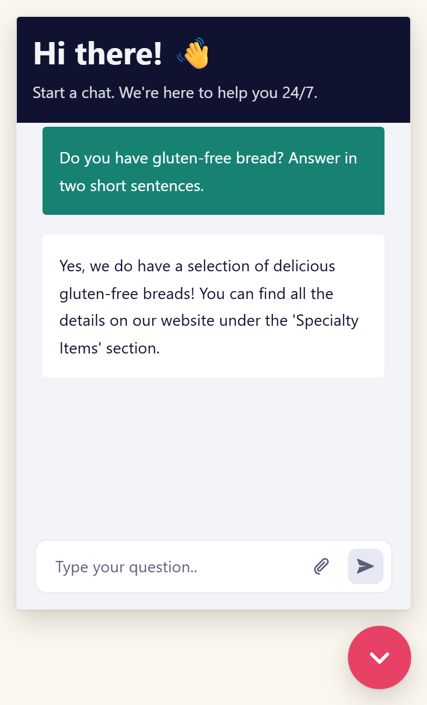
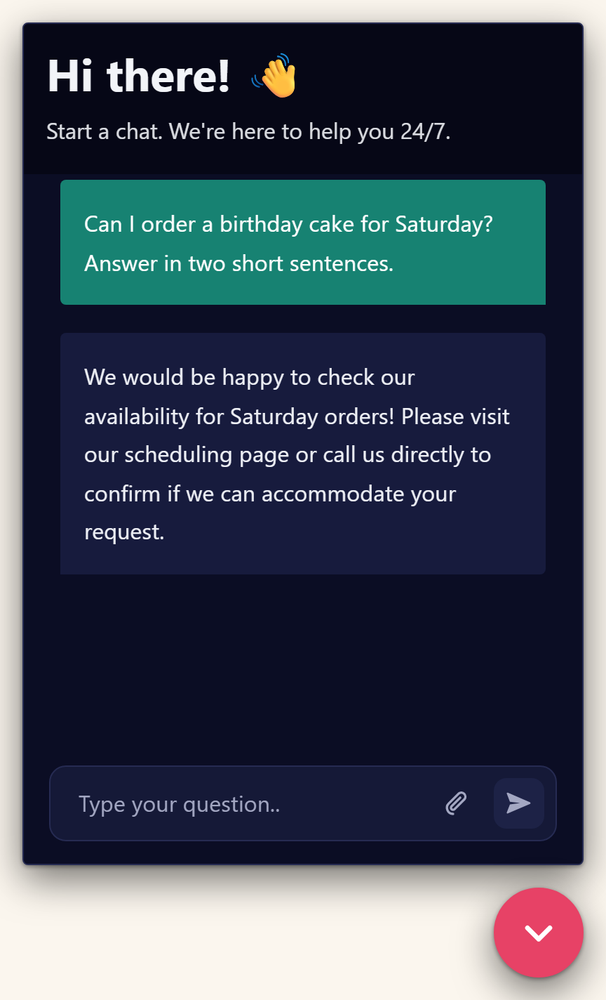

# @aparte/n8n-chat

**n8n's chat widget, drawn by [aparté](https://apartejs.dev).** `createChat()` takes
[`@n8n/chat`](https://www.npmjs.com/package/@n8n/chat)'s options and mounts the same widget on
your n8n Chat Trigger — a button in the corner, or a chat that fills its target. Change the import,
keep your call.

<p>
  
  
</p>

- Every option of `@n8n/chat` 1.43, the same defaults, the same session in the browser — and the
  Chat nodes' messages and buttons of a workflow that answers through response nodes.
- Ten languages, keyboard and screen-reader access, readable contrast, a dark scheme.
- About 100 KB (brotli) on the first load, against about 465 KB.
- A handle to drive it from your page: `open`, `close`, `toggle`, `send`, `reset`, `setDisabled`,
  `destroy`.
- MIT.

## Install

### From a CDN — no build step

```html
<link rel="stylesheet" href="https://cdn.jsdelivr.net/npm/@aparte/n8n-chat@0.1.0/dist/style.css">
<script type="module">
  import { createChat } from 'https://cdn.jsdelivr.net/npm/@aparte/n8n-chat@0.1.0/dist/cdn/n8n-chat.js';

  createChat({ webhookUrl: 'https://your-n8n.example.com/webhook/<id>/chat' });
</script>
```

`dist/cdn/n8n-chat.js` is one module with aparté inside it. What only some pages need is fetched
when used, from beside it: a language other than English, and the code highlighter with the first
code block. Keep the version in the URL: the widget you tested is the widget your visitors get.

### From npm

```bash
npm install @aparte/n8n-chat
```

```ts
import { createChat } from '@aparte/n8n-chat';
import '@aparte/n8n-chat/style.css';

const chat = createChat({ webhookUrl: 'https://your-n8n.example.com/webhook/<id>/chat' });
chat.open();
```

## Coming from `@n8n/chat`

Replace the stylesheet and the import; the call stays as it is:

```diff
- <link href="https://cdn.jsdelivr.net/npm/@n8n/chat/dist/style.css" rel="stylesheet" />
+ <link href="https://cdn.jsdelivr.net/npm/@aparte/n8n-chat@0.1.0/dist/style.css" rel="stylesheet" />
  <script type="module">
-   import { createChat } from 'https://cdn.jsdelivr.net/npm/@n8n/chat/dist/chat.bundle.es.js';
+   import { createChat } from 'https://cdn.jsdelivr.net/npm/@aparte/n8n-chat@0.1.0/dist/cdn/n8n-chat.js';
    createChat({ webhookUrl: 'https://your-n8n.example.com/webhook/<id>/chat' });
  </script>
```

The session is kept where n8n's widget keeps it (`localStorage`, key `n8n-chat/sessionId`), so a
visitor keeps their conversation across the switch. `enableStreaming` needs no tuning: a streamed
answer and a whole one are both read.

## Set up the workflow

In the **Chat Trigger** node:

1. Turn on **Make Chat Publicly Available**. The production URL that ends in `/chat` is your
   `webhookUrl`.
2. Put your site's origin in **Allowed Origins (CORS)**.
3. Choose how it answers, under **Response Mode**:
   - **Streaming** — the AI Agent streams its answer as it writes it;
   - **When Last Node Finishes** — one whole answer;
   - **Using Response Nodes** — Chat nodes send the messages, and can ask questions with buttons
     (see [Response nodes and buttons](#response-nodes-and-buttons)).
4. **Publish** the workflow.

To show a visitor's earlier messages after a reload, attach a memory to the agent, set **Load
Previous Session** to **From Memory**, and connect that memory to the Chat Trigger as well: with the
memory on the agent only, n8n answers that request with an error.

## Options

| Option | What it does | Default |
| --- | --- | --- |
| `webhookUrl` | the Chat Trigger's production URL, ending in `/chat` | required |
| `webhookConfig` | `headers` sent with every request, read each time (a refreshed token is sent); `method` is accepted, every request is a POST | `{}` |
| `target` | where it mounts: an element, or a selector | `'#n8n-chat'` |
| `mode` | `'window'` (a button in the corner) or `'fullscreen'` (fills its target) | `'window'` |
| `showWindowCloseButton` | a ✕ in the header, in window mode | `false` |
| `showWelcomeScreen` | a screen with a "New Conversation" button first | `false` |
| `loadPreviousSession` | keep the session in the browser and show its earlier messages | `true` |
| `sessionId` | use this session instead of the stored one | — |
| `chatInputKey`, `chatSessionKey` | the body fields the workflow reads | `'chatInput'`, `'sessionId'` |
| `defaultLanguage` | the language, as a tag (`'de'`, `'pt-BR'`) | `'en'` |
| `i18n` | the chrome's words by language, over the built-in ones | — |
| `locale` | the chat's own words, for a language not shipped | — |
| `initialMessages` | messages shown first, from the assistant | n8n's two |
| `messageHistory` | a conversation to show when n8n has none (text, `type: 'component'`, `transparent`) | — |
| `messageComponents` | functions that draw `type: 'component'` history messages | — |
| `metadata` | sent with every message, as `metadata` in the trigger's output | — |
| `allowFileUploads`, `allowedFilesMimeTypes` | let the person attach files, and which | `false`, any |
| `enableMessageActions` | "Repost" and "Reuse" on the person's own messages | `false` |
| `disabled` | block the input (`true`, or n8n's `{ value }`) | `false` |
| `beforeMessageSent`, `afterMessageSent` | hooks around each message | — |
| `suggestions` | questions offered above the input until the first message | — |
| `colorScheme` | `'light'`, `'dark'` or `'auto'` (the visitor's) | `'light'` |
| `fetch` | the `fetch` every request goes through | the global one |
| `enableStreaming`, `theme` | accepted for compatibility | — |

## The handle

`createChat()` returns what your page drives it with:

```ts
const chat = createChat({ webhookUrl });

chat.open();                     // open the window (close, toggle too)
chat.send('Where is my order?'); // as the visitor; waits for an answer on its way
chat.reset();                    // a new conversation, in a new session
chat.setDisabled(true);          // block the input, or let the visitor type again
chat.destroy();                  // remove it (unmount does the same)

chat.sessionId;                  // the session the conversation runs in
chat.element;                    // the widget's root element
```

## Response nodes and buttons

A Chat Trigger set to **Using Response Nodes** answers through **Chat** nodes placed in the
workflow. Each message a Chat node sends is drawn as a block of its own. A Chat node that **waits
for a written reply** gets the visitor's next message. A Chat node that **waits for an approval**
sends buttons, asked above the input with the labels you gave them; the one chosen goes back to n8n
and the workflow carries on.

**Block User Input**, on that Chat node, decides whether the visitor may write instead of choosing:
on, the answer has to be a button; off, the words reach n8n as a message and the node goes on as
not approved — as with n8n's own widget.

Up to n8n 2.45, Chat nodes run only when the Chat Trigger's **Mode** is **Hosted Chat**; an
embedded one stops with "Embedded chat is not supported". n8n 2.46 and 3.0 lift that limit and run
them in **Embedded** mode too; the widget has been tested with Hosted Chat. A button whose link
leads off your n8n is not shown.

## Files

With `allowFileUploads`, the visitor picks, drops or pastes files, and n8n receives them as
`files`, as from n8n's widget. A file can be removed with the keyboard; a picture or a file the
visitor sent opens in a new tab.

## Keeping bots out

A public Chat Trigger answers anyone who finds its URL, and every answer can cost you a call to
your AI model. [Cloudflare Turnstile](https://www.cloudflare.com/application-services/products/turnstile/)
— free, and usually invisible to people — lets the workflow stop a bot before the model runs. The
widget needs no option for it: `metadata` is read at each send and `beforeMessageSent` is awaited,
so the page puts a fresh token in `metadata` before every message.

1. In Cloudflare, add a Turnstile widget for your site's hostname. You get a **site key** (for the
   page) and a **secret key** (for n8n).
2. In the page:

```html
<link rel="stylesheet" href="https://cdn.jsdelivr.net/npm/@aparte/n8n-chat@0.1.0/dist/style.css">
<script src="https://challenges.cloudflare.com/turnstile/v0/api.js?render=explicit"></script>
<div id="turnstile"></div>
<script type="module">
  import { createChat } from 'https://cdn.jsdelivr.net/npm/@aparte/n8n-chat@0.1.0/dist/cdn/n8n-chat.js';

  // A Turnstile token is single-use and lasts five minutes: ask for a new one before each message.
  let widgetId;
  let pending;
  function turnstileToken() {
    return new Promise((resolve, reject) => {
      pending = { resolve, reject };
      if (widgetId === undefined) {
        widgetId = turnstile.render('#turnstile', {
          sitekey: '<your site key>',
          execution: 'execute',
          appearance: 'interaction-only', // shown only when Cloudflare needs the visitor to click
          callback: (token) => pending.resolve(token),
          'error-callback': () => pending.reject(new Error('Turnstile could not check this visitor')),
        });
      } else {
        turnstile.reset(widgetId);
      }
      turnstile.execute('#turnstile');
    });
  }

  const metadata = {};
  createChat({
    webhookUrl: 'https://your-n8n.example.com/webhook/<id>/chat',
    metadata,
    beforeMessageSent: async () => {
      metadata.turnstileToken = await turnstileToken();
    },
  });
</script>
```

3. In the workflow, between the Chat Trigger and your agent:
   - an **HTTP Request** node: `POST https://challenges.cloudflare.com/turnstile/v0/siteverify`,
     body as JSON:
     `{{ JSON.stringify({ secret: '<your secret key>', response: $json.metadata?.turnstileToken ?? '' }) }}`
     (anyone who can open the workflow can read the secret there);
   - an **If** node on `{{ $json.success }}` is true;
   - on its true branch, an **Edit Fields (Set)** node in JSON mode that gives the trigger's message
     back, so the agent and its memory read `chatInput` and `sessionId` as before:
     `{{ JSON.stringify($('When chat message received').item.json) }}`;
   - then your agent. The false branch ends there: nothing reaches the model.

When Cloudflare refuses a visitor, the widget shows its usual "couldn't answer" message and nothing
is sent. A visitor's reply to a waiting Chat node goes over the execution's WebSocket, which was
opened by a checked message, so it needs no token. A bot that calls the webhook directly still
starts an execution, a short one (on n8n Cloud, executions count against your plan); only a proxy in
front of n8n stops it earlier. Checked on n8n 2.45.7 with Cloudflare's test keys, text messages
only: with file uploads, check that your agent still receives the files after the Set node.

## Languages

English, French, Spanish, Portuguese (Brazil), German, Italian, Russian, Japanese, Korean and
Chinese (Simplified). A page downloads only the language it uses. Set `defaultLanguage`; override
any word of the header or the input with `i18n`; give a whole `locale` for another language.

## Look

It wears n8n's look by default and reads n8n's main `--chat--*` variables — colors, fonts, radii,
the window's size, the button — so a page that themed n8n's widget keeps most of its theme:

```css
:root {
  --chat--color--primary: #e74266;
  --chat--color--secondary: #178272;
  --chat--window--width: 420px;
}
```

CSS written against n8n's `.chat-*` classes does not carry over; the variables do.
`colorScheme: 'dark'` (or `'auto'`) gives the dark scheme. `@aparte/n8n-chat/theme.css` is the n8n
look alone, for a chat you compose yourself with
[`@aparte/runner-n8n`](https://apartejs.dev/providers/agent/n8n/) and aparté's React, Vue, Svelte
or Angular components, inside an `.aparte-n8n` element.

## Compared with `@n8n/chat`

| | `@n8n/chat` 1.43 | `@aparte/n8n-chat` |
| --- | --- | --- |
| Drive it from the page | — | `open`, `close`, `toggle`, `send`, `reset`, `setDisabled`, `destroy` |
| A new conversation | not until the browser's storage is cleared | `reset()` |
| A tool's steps after a reload | bubbles with raw JSON | left out, as while chatting |
| An error | the raw message | a sentence in the visitor's language, the workflow's own words under it, what to fix on the console |
| Languages | English | ten, loaded one at a time |
| Keyboard and screen reader | buttons without names | named controls, a labelled window, a modal sheet on a phone |
| Contrast of the visitor's bubble | 2.55:1 | 4.7:1 (WCAG AA) |
| Dark scheme | — | ✓ |
| Weight, first load (brotli) | ~465 KB | ~100 KB, +~103 KB with the first code block |
| License | Sustainable Use License | MIT |

## Versions

The widget depends on **exact** versions of aparté's packages, and moves to a newer aparté only in
a release of its own. Pin the widget's version in a CDN URL and in your `package.json`, and what you
tested is what your visitors run.

## Links

- [aparté](https://apartejs.dev) — the library it is built with.
- [`@aparte/runner-n8n`](https://apartejs.dev/providers/agent/n8n/) — the n8n protocol alone, to put
  an n8n workflow behind a chat you compose yourself.

MIT © Paul Richez
