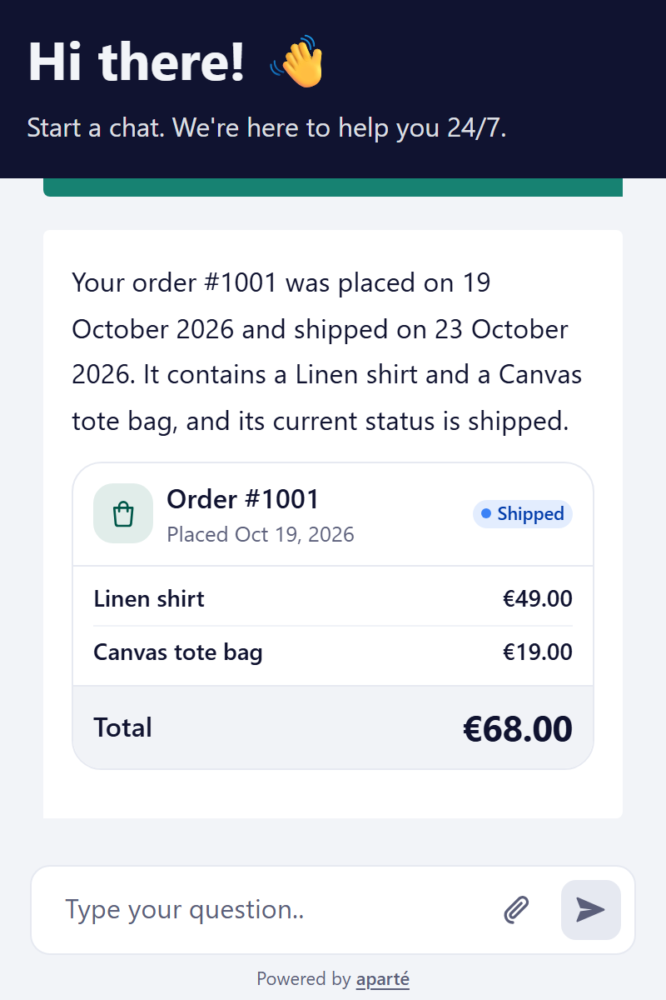
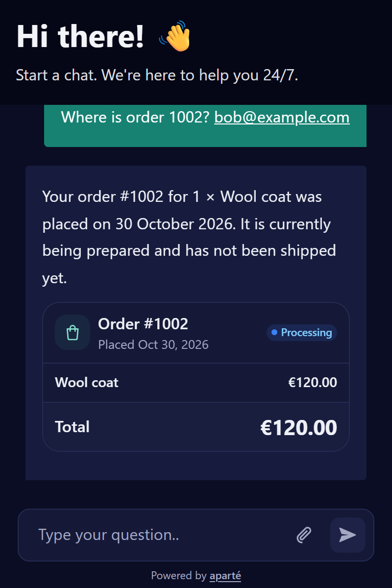

# @aparte/n8n-chat

**n8n's chat widget, drawn by [aparté](https://apartejs.dev).** `createChat()` takes
[`@n8n/chat`](https://www.npmjs.com/package/@n8n/chat)'s options and mounts the same widget on
your n8n Chat Trigger — a button in the corner, or a block in your page. Change the import, keep
your call. And your workflow can answer with **rich cards** — an order, a booking, a product, the
weather — and offer **quick replies** the visitor clicks. [See it live](https://n8n-chat.apartejs.dev).

<p>
  
  
</p>

- Rich cards your workflow writes as text: weather, order and booking, product, place, list, key
  figures, stock, plan, score, media, link. n8n's own chat shows the same answer as a code block.
- Quick replies your workflow offers the same way: buttons above the input (free times, "Yes" /
  "No"), sent with one click.
- Extensible: your own cards, and aparté's plugins (maths, diagrams, charts) through `setup`.
- Every option of `@n8n/chat` 1.43, the same defaults, the same session in the browser — and the
  Chat nodes' messages and buttons of a workflow that answers through response nodes.
- Ten languages, keyboard and screen-reader access, readable contrast, a dark scheme.
- About 155 KB compressed on the first load, against about 471 KB (measured 2026-11-10 on 1.0.1; `@n8n/chat` 1.44.7 on 2026-10-31).
- A handle to drive it from your page: `open`, `close`, `toggle`, `send`, `reset`, `setDisabled`,
  `destroy`.
- MIT. A small grey "Powered by aparté" line sits under the input, linking to [apartejs.dev](https://apartejs.dev).

## Install

### From a CDN — no build step

```html
<script type="module">
  import { createChat } from 'https://cdn.jsdelivr.net/npm/@aparte/n8n-chat@1/dist/cdn/latest.js';

  createChat({ webhookUrl: 'https://your-n8n.example.com/webhook/<id>/chat' });
</script>
```

`latest.js` loads the latest 1.x and its stylesheet, both from one exact version, so a fix reaches
your visitors on its own: within 12 hours on jsDelivr, and within a week for a browser that kept the
previous one. A 2.0 never arrives on its own. The module has aparté inside it; what only some pages
need is fetched when used, from beside it: a language other than English, and the code highlighter
with the first code block.

To keep one version until you change it, load the module and its stylesheet by their exact version
instead:

```html
<link rel="stylesheet" href="https://cdn.jsdelivr.net/npm/@aparte/n8n-chat@1.1.2/dist/style.css">
<script type="module">
  import { createChat } from 'https://cdn.jsdelivr.net/npm/@aparte/n8n-chat@1.1.2/dist/cdn/n8n-chat.js';

  createChat({ webhookUrl: 'https://your-n8n.example.com/webhook/<id>/chat' });
</script>
```

Load `n8n-chat.js` by an exact version only: through a range like `@1`, a browser could keep last
week's module and fetch its chunks from this week's version, where they no longer exist.

### From npm

```bash
npm install @aparte/n8n-chat
```

```ts
import { createChat } from '@aparte/n8n-chat';
import '@aparte/n8n-chat/style.css';

const chat = createChat({ webhookUrl: 'https://your-n8n.example.com/webhook/<id>/chat' });
chat.open();
```

## Coming from `@n8n/chat`

Replace the import and drop the stylesheet, which `latest.js` loads itself; the call stays as it is:

```diff
- <link href="https://cdn.jsdelivr.net/npm/@n8n/chat/dist/style.css" rel="stylesheet" />
  <script type="module">
-   import { createChat } from 'https://cdn.jsdelivr.net/npm/@n8n/chat/dist/chat.bundle.es.js';
+   import { createChat } from 'https://cdn.jsdelivr.net/npm/@aparte/n8n-chat@1/dist/cdn/latest.js';
    createChat({ webhookUrl: 'https://your-n8n.example.com/webhook/<id>/chat' });
  </script>
```

The session is kept where n8n's widget keeps it (`localStorage`, key `n8n-chat/sessionId`), so a
visitor keeps their conversation across the switch. `enableStreaming` needs no tuning: a streamed
answer and a whole one are both read.

## Set up the workflow

In the **Chat Trigger** node:

1. Turn on **Make Chat Publicly Available**. The production URL that ends in `/chat` is your
   `webhookUrl`.
2. Put your site's origin in **Allowed Origins (CORS)**.
3. Choose how it answers, under **Response Mode**:
   - **Streaming** — the AI Agent streams its answer as it writes it;
   - **When Last Node Finishes** — one whole answer;
   - **Using Response Nodes** — Chat nodes send the messages, and can ask questions with buttons
     (see [Response nodes and buttons](#response-nodes-and-buttons)).
4. **Publish** the workflow.

To show a visitor's earlier messages after a reload, attach a memory to the agent, set **Load
Previous Session** to **From Memory**, and connect that memory to the Chat Trigger as well: with the
memory on the agent only, n8n answers that request with an error.

## Options

| Option | What it does | Default |
| --- | --- | --- |
| `webhookUrl` | the Chat Trigger's production URL, ending in `/chat` | required |
| `webhookConfig` | `headers` sent with every request, read each time (a refreshed token is sent); `method` is accepted, every request is a POST | `{}` |
| `target` | where it mounts: an element, or a selector | `'#n8n-chat'` |
| `mode` | `'window'` (a button in the corner) or `'embedded'` (a block in the page, filling its target; `'fullscreen'`, `@n8n/chat`'s name for it, works too) | `'window'` |
| `showWindowCloseButton` | a ✕ in the [header](#the-windows-header), in window mode (there anyway while the chat fills a phone's screen or is maximized) | `false` |
| `maximizable` | a button in the [header](#the-windows-header) that maximizes the chat: `true` to the whole window, `'panel'` to a full-height panel beside the page | `false` |
| `showWelcomeScreen` | a screen with a "New Conversation" button first | `false` |
| `loadPreviousSession` | keep the session in the browser and show its earlier messages | `true` |
| `sessionId` | use this session instead of the stored one | — |
| `chatInputKey`, `chatSessionKey` | the body fields the workflow reads | `'chatInput'`, `'sessionId'` |
| `defaultLanguage` | the language, as a tag (`'de'`, `'pt-BR'`) | `'en'` |
| `i18n` | the chrome's words by language, over the built-in ones | — |
| `locale` | the chat's own words, for a language not shipped | — |
| `initialMessages` | messages shown first, from the assistant | n8n's two |
| `messageHistory` | a conversation to show when n8n has none (text, `type: 'component'`, `transparent`) | — |
| `messageComponents` | functions that draw `type: 'component'` history messages | — |
| `metadata` | sent with every message, as `metadata` in the trigger's output | — |
| `allowFileUploads`, `allowedFilesMimeTypes` | let the person attach files, and which (`'image/*,application/pdf'`, extensions too) | `false`, any |
| `cards` | draw the ` ```card-<name> ` blocks of an answer as [cards](#cards-and-quick-replies-from-a-text-answer); an object gives a card its options (`{ place: { mapTiles } }`) | `true` |
| `images` | which [pictures in an answer](#pictures-in-an-answer) load by themselves: every one, or only those from the origins you list (`['https://cdn.example.com']`; the others wait for a click) | every one |
| `waitingPrefix` | where your n8n serves a Chat node's button links, when the webhook URL does not tell ([buttons](#response-nodes-and-buttons)) | read from the webhook URL |
| `setup` | `(config) => stop?`: aparté's plugins and your own cards, on this chat ([below](#your-own-cards-and-apartés-plugins)) | — |
| `enableMessageActions` | "Repost" and "Reuse" on the person's own messages | `false` |
| `disabled` | block the input (`true`, or n8n's `{ value }`) | `false` |
| `beforeMessageSent`, `afterMessageSent` | hooks around each message | — |
| `suggestions` | questions offered above the input until the first message | — |
| `replies` | show the [quick replies](#quick-replies) an answer offers (a ` ```suggestions ` block) above the input | `true` |
| `colorScheme` | `'light'`, `'dark'` or `'auto'` (the visitor's) | `'light'` |
| `fetch` | the `fetch` every request goes through | the global one |
| `enableStreaming`, `theme` | accepted for compatibility | — |

## The window's header

In window mode the chat opens under a header: n8n's title and the line under it (`title` and
`subtitle` in `i18n`), in n8n's colors (`--chat--header--background`, `--chat--header--color`).
The ✕ is there with `showWindowCloseButton`, and always while the chat fills a phone's screen or
is maximized, where the button in the corner is not. A button that maximizes the chat is
yours to add:

```js
createChat({
  webhookUrl: 'https://your-n8n.example.com/webhook/<id>/chat',
  maximizable: true, // the whole window; 'panel' for a full-height panel that keeps the page in view
});
```

The same button, or Escape, brings it back, and `chat.maximize()` and `chat.restore()` do it from
your page. Embedded in the page (`mode: 'embedded'`), the chat keeps its own header, with nothing to
maximize.

## The handle

`createChat()` returns what your page drives it with:

```ts
const chat = createChat({ webhookUrl });

chat.open();                     // open the window (close, toggle too)
chat.maximize();                 // maximize it, restore() brings it back (give `maximizable` for the button)
chat.send('Where is my order?'); // as the visitor; waits for an answer on its way
chat.reset();                    // a new conversation, in a new session
chat.setDisabled(true);          // block the input, or let the visitor type again
chat.destroy();                  // remove it (unmount does the same)

chat.sessionId;                  // the session the conversation runs in
chat.element;                    // the widget's root element
```

## Response nodes and buttons

A Chat Trigger set to **Using Response Nodes** answers through **Chat** nodes placed in the
workflow. Each message a Chat node sends is drawn as a block of its own. A Chat node that **waits
for a written reply** gets the visitor's next message. A Chat node that **waits for an approval**
sends buttons, asked above the input with the labels you gave them; the one chosen goes back to n8n
and the workflow carries on.

**Block User Input**, on that Chat node, decides whether the visitor may write instead of choosing:
on, the answer has to be a button; off, the words reach n8n as a message and the node goes on as
not approved — as with n8n's own widget.

Up to n8n 2.45, Chat nodes run only when the Chat Trigger's **Mode** is **Hosted Chat**; an
embedded one stops with "Embedded chat is not supported". n8n 2.46 and 3.0 lift that limit and run
them in **Embedded** mode too; the widget has been tested with Hosted Chat. A button whose link
leads off your n8n is not shown, nor one whose link does not resume the running execution. The
widget reads where n8n's waiting links live from the webhook URL. Set `waitingPrefix` (a path) when
they live elsewhere: your own `N8N_ENDPOINT_WEBHOOK_WAIT`, or your own `N8N_ENDPOINT_WEBHOOK` (a
webhook URL that is not `…/webhook/<id>/chat`), where no button shows until you do.

## Cards and quick replies, from a text answer

n8n's chat carries only text, so anything richer travels as text, with one rule: **a code block
whose language the widget knows becomes part of the chat; any other is shown as code.** Two
languages are known: `card-<name>` draws a card, `suggestions` offers quick replies.

### Quick replies

The choices your workflow just offered, as buttons above the input, so the visitor clicks instead of
typing: free times, "Return an item", "Yes" / "No".

````md
Which day suits you?

```suggestions
["Tuesday 4", "Wednesday 5", "Thursday 6"]
```
````

Nothing of the block shows in the message; the replies are the last answer's, a click sends one as
if it were typed, and they go when a message is sent. A string, or an object's `label`, is both what
is shown and what is sent: a `prompt` beside it is ignored, so a button never sends words the
visitor did not read. A reply is 1 to 100 visible characters: a blank one, a longer one or one
holding invisible characters is left out (the console says so), so a label built from data — a
long product name — is best shortened.
The [booking workflow](https://n8n-chat.apartejs.dev/#workflows) offers its days and times this way:
the agent calls a small **Suggest replies** tool, and a Code node writes the block. `replies: false`
shows the blocks as code.

### Rich cards

A card is a code block whose language names the card, holding its fields as JSON, after the
sentence that answers.

````md
Order 1001 left our warehouse two days ago.

```card-order
{ "number": "1001", "status": "shipped", "total": "68.00", "currency": "EUR",
  "line_items": [{ "name": "Linen shirt", "quantity": 1, "total": "49.00" },
                 { "name": "Canvas tote bag", "quantity": 1, "total": "19.00" }] }
```
````

The widget draws the block as the card; n8n's own chat, an email or a model reading the history back
shows the sentence and the code. The cards: `weather`, `order` (a booking too, with
`"kind": "booking"`), `product`, `place`, `items`, `stats`, `stock`, `plan`, `score`, `media`,
`link`. Their fields are those of [`@aparte/plugin-cards`](https://apartejs.dev/guides/cards/), whose
readers also take the shapes shops already return (WooCommerce and Shopify orders, schema.org
products). Each card's code is fetched the first time an answer uses it.

Build the block in a **Code** node from your tool's real result rather than asking the model to
write JSON: it is exact every time, and a setting can turn it off for a chat that does not draw
cards. The [shop and booking workflows](https://n8n-chat.apartejs.dev/#workflows) do it that way.
`cards: false` shows the blocks as code.

A card's own options go in `cards`, handed to it when it loads. The place card, for one, draws a map
of its own and fetches nothing; give it your map tiles and a place with `coordinates` sits on a real
map:

```js
createChat({
  webhookUrl: 'YOUR_PRODUCTION_URL',
  cards: {
    place: {
      mapTiles: 'https://tile.openstreetmap.org/{z}/{x}/{y}.png',
      mapAttribution: '© OpenStreetMap contributors',
    },
  },
});
```

Each tile is a request from the visitor's browser to that server, which is why it is your choice:
OpenStreetMap's tiles need no key but have [a usage policy](https://operations.osmfoundation.org/policies/tiles/)
against heavy traffic; MapTiler's or Stadia's take your key in the address.

## Your own cards, and aparté's plugins

The widget is built with [aparté](https://apartejs.dev), and `setup` hands you its config: anything
aparté does, this chat can do. A card of your own is a `defineCard`, and your workflow sends it as
` ```card-<its name> `:

```js
import { createChat, defineCard, el } from '@aparte/n8n-chat';

const ticket = defineCard({
  name: 'ticket',
  variants: ['card'],
  // A card draws its own padding, from the kit's variable, as the shipped cards do.
  styles: '.aparte-ticket-card { padding: var(--aparte-rich-card-padding) } .aparte-ticket-card .id { font-weight: 600 }',
  icon: '<svg viewBox="0 0 24 24"><path d="M4 6h16v12H4z" fill="none" stroke="currentColor"/></svg>',
  normalize: (raw) => (raw?.id ? { id: String(raw.id), subject: String(raw.subject ?? ''), status: raw.status } : null),
  render: (t) => [el('span', { class: 'id', text: t.id }), el('p', { text: t.subject }), el('small', { text: t.status })],
  skeleton: () => [],
  label: (t) => `Ticket ${t?.id ?? ''}`,
  fallback: (t) => `Ticket ${t.id}: ${t.subject}`,
});

createChat({
  webhookUrl: '…',
  setup: (config) => ticket.setup({ config }),
});
```

Take `defineCard` from the widget's own module, as above, and from the same URL when you load
it from a CDN (`…/@aparte/n8n-chat@1/dist/cdn/latest.js`): the card and the chat then share
one copy of aparté. A kit loaded from another URL keeps its cards where the chat never looks.

````md
Your ticket is open.

```card-ticket
{ "id": "T-42", "subject": "Refund for order 1001", "status": "Waiting for us" }
```
````

The same `setup` adds aparté's plugins — maths, diagrams, charts — each in one line:

```js
import { setupKatex } from '@aparte/plugin-katex';
import 'katex/dist/katex.min.css'; // KaTeX's own sheet: without it a formula shows twice
import { setupMermaid } from '@aparte/plugin-mermaid';

createChat({
  webhookUrl: '…',
  setup: (config) => {
    const stops = [setupKatex({}, config), setupMermaid({}, config)];
    return () => stops.forEach((stop) => stop());
  },
});
```

What `setup` returns, if a function, runs on `destroy()`.

### All of aparté, at three levels

The widget's options keep `@n8n/chat`'s names so a page switches without rewriting, but everything
underneath is aparté, and you can reach it:

- **The config** — `setup(config)` hands you the chat's own `AparteConfig`: plugins, cards, segment
  and tool renderers, icons (`config.registerIcons`), the locale (`config.setLocale`), the actions on a
  message (`config.registerAction`). See the [configuration guide](https://apartejs.dev/guides/customization/).
- **The elements** — `chat.element` is the widget's root; the chat inside it is aparté's
  `<aparte-chat>`, its field `<aparte-composer>`, and their attributes are theirs to set:

  ```js
  const chat = createChat({ webhookUrl: '…' });
  chat.element.querySelector('aparte-composer')?.setAttribute('placeholder', 'Ask about your order…');
  ```
- **The look** — aparté's `--aparte-*` variables, beside n8n's `--chat--*` ones:

  ```css
  /* n8n's variables for what n8n's widget already styles; aparté's for the rest. */
  .aparte-n8n { --chat--message--border-radius: 14px; --aparte-font-family: 'Inter', sans-serif; }
  /* The theme maps some aparté tokens from n8n's on the chat itself: set those there. */
  .aparte-n8n aparte-chat { --aparte-radius-input: 20px; }
  ```

What does not apply here is what needs the agent's loop in the page — a tool run in the browser, an
approval of a tool call: an n8n workflow runs its tools itself, on n8n.

## The page the visitor is on

`metadata` is sent with every message and reaches the workflow as `$json.metadata`. Send the page,
and the workflow knows which product "this one" is:

```js
createChat({
  webhookUrl: '…',
  metadata: { page: location.href, title: document.title },
});
```

## In the page, not in a corner

`mode: 'embedded'` puts the chat in your page as a block, filling its `target`, which needs a
height. `'fullscreen'`, `@n8n/chat`'s name for the same mode, works too.

```html
<div id="support-chat" style="height: 600px"></div>
<script type="module">
  createChat({ webhookUrl: '…', target: '#support-chat', mode: 'embedded' });
</script>
```

## Files

With `allowFileUploads`, the visitor picks, drops or pastes files, and n8n receives them as
`files`, as from n8n's widget. A file can be removed with the keyboard; a picture or a file the
visitor sent opens in a new tab.

## Pictures in an answer

A picture an answer names loads by itself, as in n8n's own widget: nothing to set. If your workflow
reads content you do not control — e-mails, web pages, a document a visitor sends — name the
origins your pictures come from. A model steered by such content can write the conversation into a
picture's address, and the browser fetches it without a click; with `images`, any other picture
waits behind a link that names its host, until the visitor clicks it. The same list decides a
media card's video and sound.

```js
createChat({ webhookUrl: '…', images: ['https://cdn.example.com'] });
```

An origin is written with its scheme: `'https://cdn.example.com'` (a bare host allows nothing).
`'self'` is your page's own origin, `true` or `'*'` every picture, `false` none by itself, and a
function decides each address (`'load'`, `'hold'` or `'drop'`).

## Keeping bots out

A public Chat Trigger answers anyone who finds its URL, and every answer can cost you a call to
your AI model. [Cloudflare Turnstile](https://www.cloudflare.com/application-services/products/turnstile/)
— free, and usually invisible to people — lets the workflow stop a bot before the model runs. The
widget needs no option for it: `metadata` is read at each send and `beforeMessageSent` is awaited,
so the page puts a fresh token in `metadata` before every message.

1. In Cloudflare, add a Turnstile widget for your site's hostname. You get a **site key** (for the
   page) and a **secret key** (for n8n).
2. In the page:

```html
<script src="https://challenges.cloudflare.com/turnstile/v0/api.js?render=explicit"></script>
<div id="turnstile"></div>
<script type="module">
  import { createChat } from 'https://cdn.jsdelivr.net/npm/@aparte/n8n-chat@1/dist/cdn/latest.js';

  // A Turnstile token is single-use and lasts five minutes: ask for a new one before each message.
  let widgetId;
  let pending;
  function turnstileToken() {
    return new Promise((resolve, reject) => {
      pending = { resolve, reject };
      if (widgetId === undefined) {
        widgetId = turnstile.render('#turnstile', {
          sitekey: '<your site key>',
          execution: 'execute',
          appearance: 'interaction-only', // shown only when Cloudflare needs the visitor to click
          callback: (token) => pending.resolve(token),
          'error-callback': () => pending.reject(new Error('Turnstile could not check this visitor')),
        });
      } else {
        turnstile.reset(widgetId);
      }
      turnstile.execute('#turnstile');
    });
  }

  const metadata = {};
  createChat({
    webhookUrl: 'https://your-n8n.example.com/webhook/<id>/chat',
    metadata,
    beforeMessageSent: async () => {
      metadata.turnstileToken = await turnstileToken();
    },
  });
</script>
```

3. In the workflow, between the Chat Trigger and your agent:
   - an **HTTP Request** node: `POST https://challenges.cloudflare.com/turnstile/v0/siteverify`,
     body as JSON:
     `{{ JSON.stringify({ secret: '<your secret key>', response: $json.metadata?.turnstileToken ?? '' }) }}`
     (anyone who can open the workflow can read the secret there);
   - an **If** node on `{{ $json.success }}` is true;
   - on its true branch, an **Edit Fields (Set)** node in JSON mode that gives the trigger's message
     back, so the agent and its memory read `chatInput` and `sessionId` as before:
     `{{ JSON.stringify($('When chat message received').item.json) }}`;
   - then your agent. The false branch ends there: nothing reaches the model.

When Cloudflare refuses a visitor, the widget shows its usual "couldn't answer" message and nothing
is sent. A visitor's reply to a waiting Chat node goes over the execution's WebSocket, which was
opened by a checked message, so it needs no token. A bot that calls the webhook directly still
starts an execution, a short one (on n8n Cloud, executions count against your plan); only a proxy in
front of n8n stops it earlier. Checked on n8n 2.45.7 with Cloudflare's test keys, text messages
only: with file uploads, check that your agent still receives the files after the Set node.

## Languages

Ten ship: English, French, Spanish, Portuguese (Brazil), German, Italian, Russian, Japanese, Korean
and Chinese (Simplified). A page downloads only the language it uses.

### Pick one

```js
createChat({
  webhookUrl: '…',
  defaultLanguage: 'fr', // a tag: 'de', 'pt-BR', 'zh-CN'… 'fr-CA' reads in French
});
```

The header, the first messages, the input and the chat's own words (its buttons, its error card,
what a screen reader hears) all switch. To follow the visitor's browser, pass
`defaultLanguage: navigator.language`: a language not shipped reads in English, left to right,
until you give its words ([below](#another-language-right-to-left-included)); `i18n` words under
`ar` serve `ar-SA` too.

### Change a few words

`i18n` takes the header's and the input's words by language, over the built-in ones:

```js
createChat({
  webhookUrl: '…',
  defaultLanguage: 'fr',
  i18n: { fr: { title: 'Bonjour 👋', subtitle: 'Une question sur votre commande ?', inputPlaceholder: 'Votre question…' } },
  initialMessages: ['Bonjour ! Comment puis-je vous aider ?'],
});
```

The keys: `title`, `subtitle`, `footer`, `inputPlaceholder`, `getStarted`, `closeButtonTooltip`,
`poweredBy` (`{aparte}` stands for the link), `repostButton` and `reuseButton`.

### Another language, right to left included

A language that does not ship takes its words from you: `i18n` for the header and the input, and
aparté's locale, through `setup`, for the chat's own. Arabic, Hebrew, Persian, Urdu and the other
right-to-left languages turn the whole widget right to left from their tag alone — header, messages,
input, and the launcher, which moves to the bottom left — even on a left-to-right page. Code, a
formula or an English answer inside it still read left to right.

```js
createChat({
  webhookUrl: '…',
  defaultLanguage: 'ar',
  i18n: {
    ar: {
      title: 'مرحبا 👋',
      subtitle: 'نحن هنا لمساعدتك.',
      inputPlaceholder: 'اكتب سؤالك…',
      closeButtonTooltip: 'إغلاق',
      poweredBy: 'بدعم من {aparte}',
    },
  },
  initialMessages: ['مرحبا! كيف يمكنني مساعدتك اليوم؟'],
  // The chat's own words, over the English ones: the type lists every key.
  setup: (config) => config.setLocale({ ...config.getLocale(), tag: 'ar', sendButton: 'إرسال', copy: 'نسخ' }),
});
```

A page that is right to left already (`<html dir="rtl">`) needs nothing more: the widget follows it in
any language.

## Colors

Your brand color, in one line. It colors the visitor's bubble, the send button, the links and the
button in the corner, in light and in dark:

```css
:root {
  --chat--color--secondary: #c2410c;
}
```

Keep white text readable on it: 4.5:1 or more (n8n's own `#20b69e` gives 2.55:1, which is why the
default here is `#178272`). Two more lines give the chat its own surroundings:

```css
:root {
  --chat--header--background: #9a3412; /* the bar with the title */
  --chat--body--background: #fbf2ec;   /* behind the messages, in light */
}
```

| Variable | What it changes | When unset |
| --- | --- | --- |
| `--chat--color--secondary` | your bubble, the send button, links; tints the dark surfaces | `#178272` |
| `--chat--color--primary` | the button in the corner, when it should differ | `--secondary`, else n8n's `#e74266` |
| `--chat--header--background` / `--chat--header--color` | the title bar, in light and in dark | n8n's navy / `#f2f4f8` |
| `--chat--body--background` | behind the messages (light) | `#f2f4f8` |
| `--chat--message--bot--background` / `--chat--message--user--background` | one side's bubbles | white / `--secondary` |
| `--chat--font-family`, `--chat--border-radius`, `--chat--window--width` / `--height` | type, corners, the window | n8n's |

Hovers are derived from the color they darken, so one color never hovers back to n8n's green.

**Dark.** `colorScheme: 'dark'` always, `'auto'` when the visitor's system is dark (n8n's widget has
no dark scheme). It keeps your header and tints its navy with your `--secondary`, so the line above
is enough. For your own dark surfaces, set aparté's variables on the widget when it is dark:

```css
.aparte-n8n[data-aparte-theme='dark'] {                 /* colorScheme: 'dark' */
  --aparte-bg: #1a100a;                  /* behind the messages */
  --aparte-surface-1: #2a1a11;           /* the field, the cards */
  --aparte-border: #4a2c1d;
  --aparte-message-content-bg-assistant: #2c1b12;
}
/* colorScheme: 'auto': the same, inside @media (prefers-color-scheme: dark)
   on .aparte-n8n:not([data-aparte-theme]) */
```

A page that themed n8n's widget keeps its variables; CSS written against n8n's `.chat-*` classes
does not carry over. Try a color, a header and the dark scheme side by side on
[n8n-chat.apartejs.dev](https://n8n-chat.apartejs.dev/#demo), which writes the CSS for you. `@aparte/n8n-chat/theme.css` is the n8n
look alone, for a chat you compose yourself with
[`@aparte/runner-n8n`](https://apartejs.dev/providers/agent/n8n/) and aparté's React, Vue, Svelte
or Angular components, inside an `.aparte-n8n` element.

## Compared with `@n8n/chat`

| | `@n8n/chat` (options checked on 1.43.3, weight on 1.44.7) | `@aparte/n8n-chat` |
| --- | --- | --- |
| Drive it from the page | — | `open`, `close`, `toggle`, `send`, `reset`, `setDisabled`, `destroy` |
| A new conversation | not until the browser's storage is cleared | `reset()` |
| A tool's steps after a reload | bubbles with raw JSON | left out, as while chatting |
| An error | the raw message | a sentence in the visitor's language; the workflow's own words and what to fix, on the console |
| Languages | English | ten, loaded one at a time |
| Keyboard and screen reader | buttons without names | named controls, a labelled window, a modal sheet on a phone |
| Contrast of the visitor's bubble | 2.55:1 | 4.7:1 (WCAG AA) |
| Dark scheme | — | ✓ |
| Rich cards | the JSON as text | drawn: order, booking, product, weather… |
| Quick replies offered by an answer | the block as code | buttons above the input |
| Weight, first load (compressed) | ~471 KB | ~155 KB |
| License | Sustainable Use License | MIT |

## Versions

From 1.0.0 the widget follows semantic versioning: the options of `createChat`, the handle it
returns, what the module exports (the card kit included), the `i18n` keys, the `--chat--*`
variables, the `.aparte-n8n` root with its `data-aparte-theme`, and the files a page loads
(`dist/cdn/latest.js`, `dist/cdn/n8n-chat.js`, `dist/style.css`, `./theme.css`) keep their names, and
what they do, until 2.0. A security fix may refuse what was accepted in any release, and says so first
in its notes.

The widget depends on **exact** versions of aparté's packages, and moves to a newer aparté only in a
release of its own: within a day of a new aparté 1.x, a patch release of the widget carries it, once
its tests pass. `@1/dist/cdn/latest.js` brings it to your page on its own. To decide when, pin the
exact version in the CDN URLs and in your `package.json`: what you tested is what your visitors run.

## Links

- [n8n-chat.apartejs.dev](https://n8n-chat.apartejs.dev) — the live demo, and workflows to start from.
- [aparté](https://apartejs.dev) — the library it is built with.
- [`@aparte/runner-n8n`](https://apartejs.dev/providers/agent/n8n/) — the n8n protocol alone, to put
  an n8n workflow behind a chat you compose yourself.

MIT © Paul Richez
